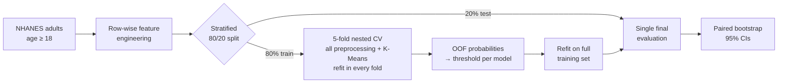

# CVD Prediction on NHANES with Clustering-Augmented (Hybrid) Classifiers

Can **unsupervised** patient clusters make **supervised** cardiovascular disease (CVD) prediction better?

This repository contains a leakage-safe machine learning pipeline on adult NHANES participants. It compares four classifiers trained on standard clinical features (**Baseline**) with the same classifiers given extra K-Means cluster features (**Hybrid**).

**Author:** Sadia Tasnim Barsha

---

## Study design



### Feature representations

| Representation | Features | Role |
|---|---|---|
| **Baseline** | Clinical/demographic predictors + engineered risk features | Reference |
| **Pure Hybrid** | Baseline + `Cluster_Label` + `Distance_to_Centroid_k` | Primary hybrid model, no outcome information |
| **Augmented Hybrid** | Pure Hybrid + `Cluster_CVD_Rate` (out-of-fold target encoding) | Secondary sensitivity analysis |

### Classifiers and imbalance handling

| Classifier | Imbalance strategy |
|---|---|
| Logistic Regression | SMOTE (0.7), training folds only |
| Random Forest | SMOTE (0.7), training folds only |
| SVM (RBF) | `class_weight="balanced"` |
| XGBoost | `scale_pos_weight` |

Hyperparameters are fixed and identical across representations, so differences within a classifier come from the cluster features alone.

### Leakage controls
- The test set is used **once**, after all modelling decisions are fixed.
- Missing-column filtering, IQR outlier capping, imputation, scaling, K-Means, target encoding and SMOTE are fitted on training data only, and are **refitted inside each CV fold**.
- Decision thresholds are chosen from **training out-of-fold predictions** (maximise F1 subject to recall ≥ 0.70).
- The primary model for the bootstrap comparison is selected by **training OOF F1**, not by test results.

### Statistical comparison
For each classifier, the Pure Hybrid is compared with its **matched Baseline** using a paired bootstrap of the test set (1,000 resamples). A change is reported as an improvement or a decline only when the 95% interval excludes zero.

---

## Repository structure

```
.
├── NHANES_CVD_Hybrid_Clustering.ipynb   # full pipeline with explanations
├── requirements.txt
├── data/
│   └── README.md                        # expected dataset format (data file not included)
└── outputs/                             # created when the notebook runs
    ├── RESULTS_SUMMARY.md               # auto-generated results and interpretation
    ├── results_all_12_models.csv        # final test metrics (single source of truth)
    ├── oof_thresholds_and_metrics.csv
    ├── hybrid_minus_baseline_deltas.csv
    ├── bootstrap_95ci_pure_vs_baseline.csv
    ├── cluster_stability_summary.csv
    └── figures/                         # all figures as PNG
```

## How to run

```bash
git clone https://github.com/<your-username>/nhanes-cvd-hybrid-clustering.git
cd nhanes-cvd-hybrid-clustering
python -m venv .venv && source .venv/bin/activate   # Windows: .venv\Scripts\activate
pip install -r requirements.txt
# put NHANES_FINAL_DATASET.csv in data/  (see data/README.md)
jupyter notebook NHANES_CVD_Hybrid_Clustering.ipynb
```

Run all cells from top to bottom. All study settings (split size, K, folds, SMOTE ratio, recall floor, bootstrap size) are in the configuration cell near the top. The nested cross-validation step takes a few minutes because of the SVM.

It also runs on Google Colab: upload the notebook and the CSV, then run `!pip install imbalanced-learn xgboost` first.

## Results

After the notebook has run, the main results are in [`outputs/RESULTS_SUMMARY.md`](outputs/RESULTS_SUMMARY.md) and the figures in [`outputs/figures/`](outputs/figures/).

## Limitations

- NHANES survey weights and design variables are not used, so estimates describe the analytic sample and are not nationally representative.
- The data are cross-sectional: the models identify existing CVD and do not forecast future events.
- SMOTE interpolates one-hot encoded categories (SMOTENC is an alternative).
- Hyperparameters are fixed, not tuned.
- Bootstrap intervals reflect test-set sampling variability only.
- There is no external validation, and the models are not for clinical use.

## Changes in this version

This version corrects the earlier analysis notebook:

- **Bug fix:** IQR capping no longer touches binary flags or zero-IQR columns. Previously `High_HbA1c_Risk` was capped to a constant 0 and contributed nothing.
- **Bug fix:** the baseline-vs-hybrid comparison table now matches model names correctly (it was previously always empty).
- Risk flags stay missing when the underlying measurement is missing, rather than being set to 0 ("no risk").
- High-missing columns are identified on the training set only.
- Each classifier uses one imbalance correction (previously Logistic Regression and Random Forest used SMOTE **and** class weights).
- `Cluster_Size` was removed from the hybrid features because it duplicates `Cluster_Label`.
- The exploratory single-split models were removed, so there is now one consistent set of results. The bootstrap now covers all four classifiers against matched baselines.
- All interpretation text (silhouette description, improvement claims) is generated from the computed results instead of being hard-coded.
- Shared functions are defined once (no variable shadowing), and all tables and figures are saved to `outputs/`.

## Data source

National Health and Nutrition Examination Survey (NHANES), U.S. Centers for Disease Control and Prevention, National Center for Health Statistics: <https://www.cdc.gov/nchs/nhanes/>
